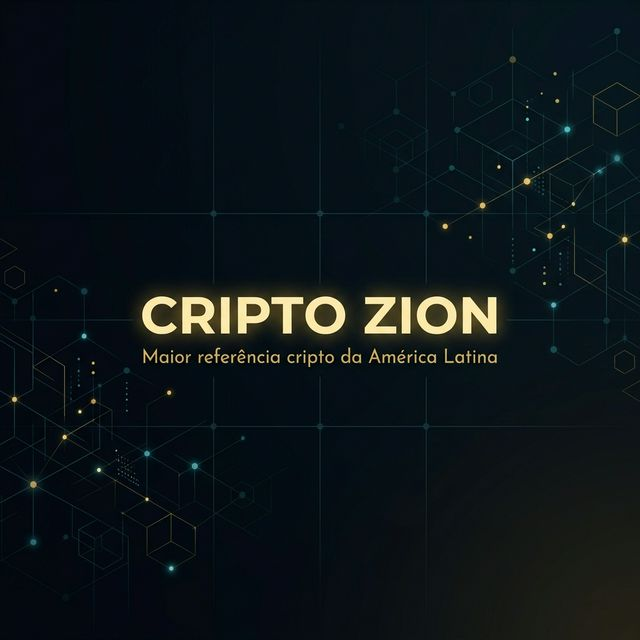

  

<h1 align="center">
  👋 Fala! Eu sou o <a href="https://criptozion.xyz" target="_blank">Fealty</a>
</h1>

  <b>Fundador do <a href="https://criptozion.xyz">Cripto Zion</a></b> — construindo a maior referência cripto da América Latina 🌎

  
  
  
  

---

### 🏛️ Sobre o Cripto Zion

Cripto Zion é uma comunidade de educação e investimento em criptomoedas com foco em **estratégias de longo prazo**. Nada de promessas milagrosas — aqui é **pedra sobre pedra**.

> *"Construir riqueza constante — não da noite para o dia, mas pedra sobre pedra."*

🎯 **Missão:** Tornar o mercado cripto acessível e estratégico para investidores da América Latina.

---

### 🧠 O que construímos

<table>
  <tr>
    <td align="center" width="33%">
      <h4>📊 Zion Smart DCA</h4>
      
Estratégia proprietária de Dollar Cost Averaging com indicadores on-chain (RSI, Fear & Greed)

    </td>
    <td align="center" width="33%">
      <h4>🎓 Zion Academy</h4>
      
4 trilhas de aprendizado: do iniciante ao avançado — DeFi, Pools, Segurança

    </td>
    <td align="center" width="33%">
      <h4>📈 Dashboard DCA</h4>
      
Tracker de portfólio com preços ao vivo, Fear & Greed Index e calculadora

    </td>
  </tr>
  <tr>
    <td align="center" width="33%">
      <h4>🤖 Bot Telegram</h4>
      
Alertas diários de preço, F&G e resumo do mercado cripto

    </td>
    <td align="center" width="33%">
      <h4>📝 Blog & Artigos</h4>
      
Conteúdo educacional com artigos free e premium sobre cripto

    </td>
    <td align="center" width="33%">
      <h4>💼 Carteira "Trust Me Bro"</h4>
      
Carteira comunitária com aportes reais seguindo o Smart DCA

    </td>
  </tr>
</table>

---

### ⚙️ Stack & Ferramentas

  
  
  
  
  
  
  
  
  
  
  
  

---

### 📊 Estratégias que ensinamos

| Estratégia | Descrição |
|:----------:|:----------|
| 💰 **DCA** | Dollar Cost Averaging — aportes consistentes, independente do preço |
| 📉 **Smart DCA** | DCA otimizado com RSI + Fear & Greed Index |
| 🏊 **Pools de Liquidez** | Rendimento passivo via DeFi (Uniswap, Aerodrome, Orca) |
| 🎯 **Scaling Out** | Saída parcial nos alvos — nunca é tudo ou nada |

---

### 🔗 Links Úteis

| | Link |
|:--:|:-----|
| 🌐 | **[criptozion.xyz](https://criptozion.xyz)** — Site principal |
| 📊 | **[app.criptozion.xyz](https://app.criptozion.xyz)** — Dashboard DCA |
| 🎓 | **[Academy](https://criptozion.xyz/academy.html)** — Trilhas de aprendizado |
| 📰 | **[Blog](https://criptozion.xyz/blog.html)** — Artigos educacionais |
| 🧮 | **[Calculadora](https://criptozion.xyz/calculadora.html)** — Simulador DCA |
| 📰 | **[Newsletter](https://criptozion.xyz/newsletter.html)** — Fique por dentro |

---

  
  

  <i>NÃO é conselho de investimento. Faça sua própria pesquisa (DYOR).</i>

